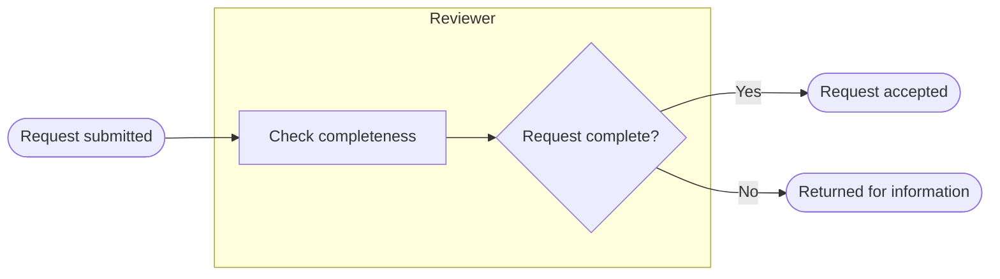

# Process Mapping

Map a supported current-state or proposed future-state process so a reader can follow triggers, responsibility, decisions, and outcomes. A diagram must not introduce policy simply to close a branch.

## Contracts and inputs

Read [COMMON.md](../../references/COMMON.md). Read [PROJECT_CONTEXT.md](../../references/PROJECT_CONTEXT.md) when project conventions, actor mappings, or hierarchy matter.

Use source narratives, notes, existing maps, or explicitly supplied process descriptions. Identify scope, current/future state, audience, start trigger, end states, actors, branch conditions, and exception handling. Ask targeted questions for material missing boundaries or conflicting policy. If a provisional map is requested, label unknown nodes/branches and list questions; do not present it as validated.

## Workflow

1. **Define boundaries**: triggering event, prerequisites, terminal states, and any upstream/downstream processes deliberately outside the map.
2. **Inventory evidence**: map source IDs/version/sections to steps and decisions. Separate existing behavior, confirmed future behavior, and proposed changes.
3. **Identify actors**: use meaningful `subgraph` groups for responsible people/systems, not decorative boxes. A lane is responsibility, not inferred permission or implementation ownership.
4. **Draft happy path**: connect start to a named end outcome with concise verb-noun labels.
5. **Add branches**: copy decision conditions from sources; label each outgoing edge. Distinguish yes/no from genuinely multi-way decisions. Preserve thresholds, negations, and boundary conditions exactly as supported.
6. **Add exceptions**: rejection, error, cancellation, timeout, rework, and escalation only where supported. Record who handles each known exception and its outcome. Unknown handling remains an explicit open item, not an invented retry/escalation rule.
7. **Walk every path** against evidence. Verify reachability, branch coverage, responsibility transitions, loops and exit conditions, and terminal outcomes. Trace both acceptance and rejection paths.
8. **Check readability and Mermaid structure** as below. Report manual inspection separately from actual parser/render checks.
9. **Deliver** the diagram plus legend, source coverage, and unresolved questions. Save a standalone map to the confirmed process-map category or embed in the requested parent deliverable; do not save both by default.

## Mermaid conventions

Default to `flowchart LR`; use another direction when the requested medium or readability warrants it. This is a presentation default, not policy. Prefer short, descriptive labels; unique stable node IDs; explicit start/end nodes; and quoted labels where punctuation needs protection.

| Shape | Syntax | Meaning |
|---|---|---|
| Stadium | `A(["Request received"])` | Trigger or terminal outcome |
| Rectangle | `A["Review request"]` | Action |
| Diamond | `A{"Request complete?"}` | Decision |
| Parallelogram | `A[/"Request details"/]` | Input/output |
| Subroutine | `A[["Perform review"]]` | Named sub-process |

Use `-->` for flow and `-->|Condition|` for labeled flow. Do not use a reserved keyword such as lowercase `end` as a node ID. Close every subgraph with `end`; balance quotes, brackets, and code fences. Referencing the same declared node ID is intentional reuse, not permission to give different nodes the same ID.

## Bounded example

Assumed source for this illustration: a requester submits a form; a reviewer checks completeness; complete requests are accepted, incomplete requests are returned. No retry policy is specified.

Source coverage note: what happens after return is outside this supplied scope, not assumed to loop automatically. If return handling itself were unknown, show an explicitly unresolved outcome and ask rather than using this example as policy.

## Output and checks

- Title, purpose, current/future/proposed status, source inventory and scope boundaries.
- Mermaid diagram; legend only where needed; source-to-node/branch references for material rules.
- Exceptions/ownership and open items, including unsupported branch handling and confirmation needed.
- Every meaningful node reachable from a supported start; no accidental disconnected nodes. Every supported path reaches a terminal/handoff or a documented loop with its exit condition; unresolved paths are visibly marked.
- All outgoing decision branches labeled and consistent with evidence. “Otherwise” is not a substitute for a missing business rule.
- Verify Mermaid delimiters, node declarations, edge endpoints and subgraph boundaries manually. If an approved renderer is available, validate using it and report the observed result; otherwise state “not rendered.” Do not install a renderer without authorization.
- Split large maps into linked sub-processes instead of unreadably dense diagrams, preserving all handoffs and references.
- A rendered diagram proves syntax/layout only, not business correctness. Record whether stakeholders validated the process; never imply approval from render success.
- Resolve paths/collisions under the shared contract before actual writes; report exact saved path and validation limits.
